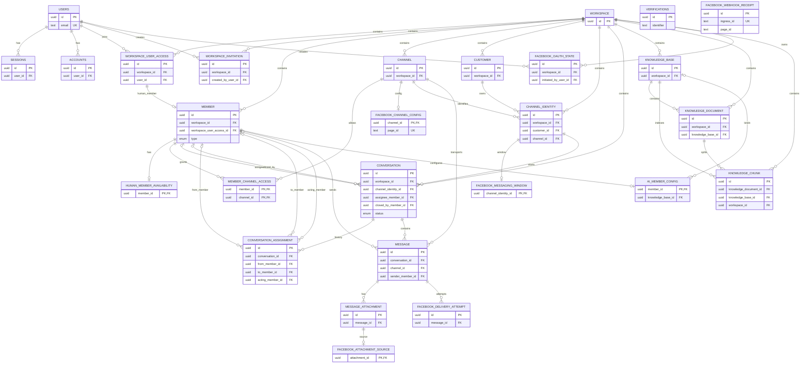

# Database ER Relationships

当前图以 [`packages/db/src/schema.ts`](packages/db/src/schema.ts) 中的实际 Drizzle schema 为准。

## Important constraints

- `channel_identity(channel_id, external_user_id)` 唯一。
- 一个 `channel_identity` 最多一个 `OPEN` conversation。
- `member_channel_access(member_id, channel_id)` 是复合主键。
- `message(channel_id, external_message_id)` 在外部消息 ID 不为空时唯一，用于 webhook 幂等。
- `facebook_webhook_receipt` 是独立的 Facebook 诊断/幂等记录，不直接外键关联核心业务表。
- `conversation.last_customer_message_id` 是逻辑引用，当前没有数据库外键。
- 规格要求的 `ai_response_run` 当前尚未出现在实际 schema 或 migration 中；实现 AI runtime 时需要补充。
